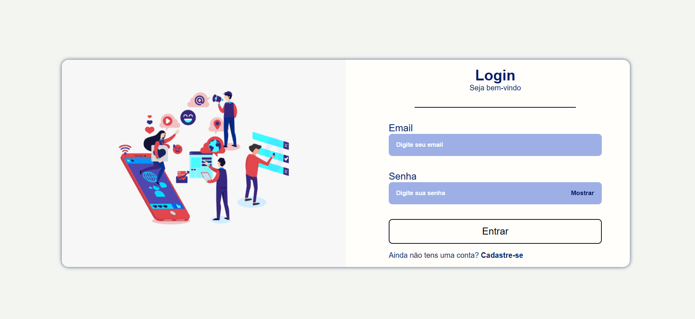
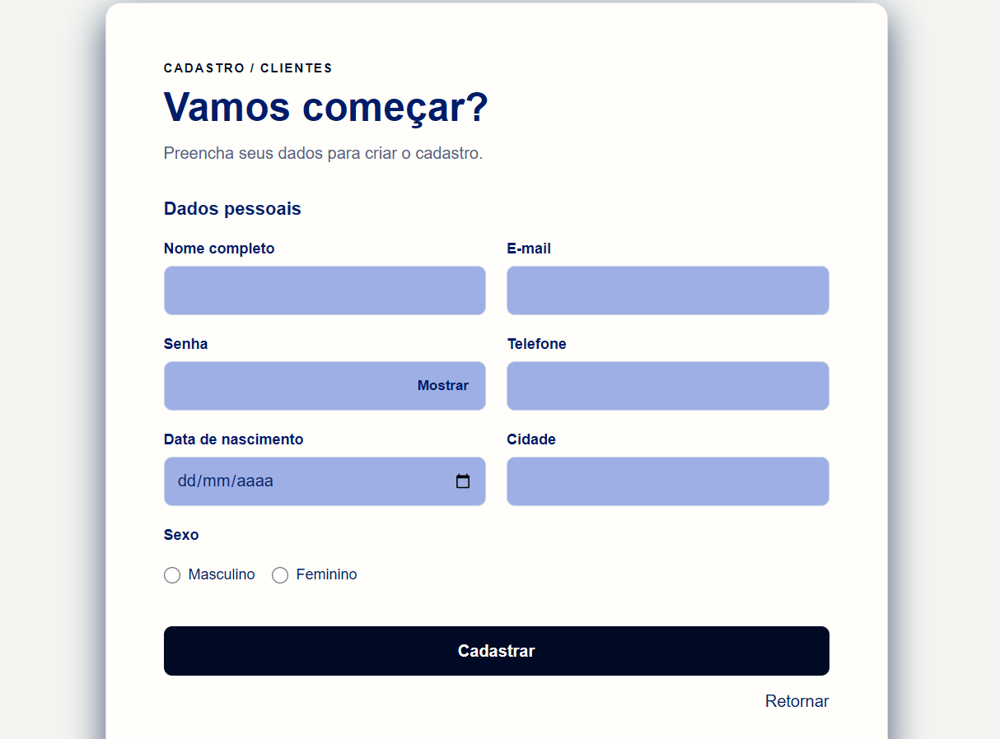
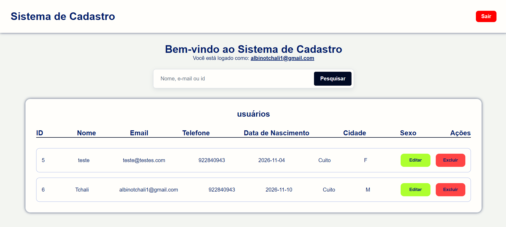
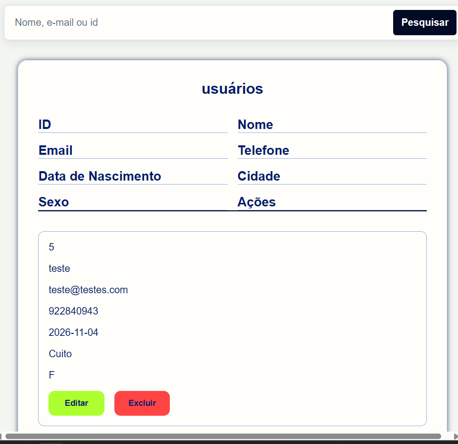

# Sistema de Cadastro

Aplicação web de cadastro e gestão de usuários, desenvolvida em PHP e MySQL.

## Imagens do projeto

### Login em ecrã largo



### Login em ecrã estreito


### Formulário de cadastro



### Área de usuários em ecrã largo



### Área de usuários em ecrã estreito



## Funcionalidades

- Criar uma conta e iniciar sessão.
- Pesquisar registros por nome, e-mail ou ID.
- Consultar, editar e excluir registros.
- Mostrar ou ocultar a senha nos formulários.
- Armazenar senhas usando `password_hash` e validá-las com `password_verify`.

## Requisitos

- PHP com as extensões MySQLi e sessões ativadas.
- MySQL ou MariaDB.
- Um servidor web com suporte a PHP. Para desenvolvimento, pode usar o servidor
  embutido do PHP.

## Configuração

1. Inicie o servidor MySQL.
2. Crie a base de dados e a tabela executando [`src/sql/database.sql`](./src/sql/database.sql)
   através de uma ferramenta como phpMyAdmin ou da linha de comandos. O script
   também contém comandos para criar um usuário local do MySQL; ajuste esses
   comandos às suas credenciais ou omita-os se já tiver um usuário configurado.
3. Abra [`config.php`](./config.php) e configure `HOST`, `USER`, `PASS` e `BASE`
   para corresponder ao seu servidor MySQL e à base de dados `cadastro`.
4. Guarde as credenciais localmente. Não use credenciais de desenvolvimento em
   produção nem as publique em repositórios.

## Executar localmente

Na pasta `projeto-1`, inicie o servidor embutido:

```sh
php -S 127.0.0.1:8000
```

Abra <http://127.0.0.1:8000/> no navegador para aceder ao login. Crie primeiro
uma conta em **Cadastre-se**. O servidor MySQL deve continuar ativo enquanto
utiliza a aplicação.

## Estrutura

```text
projeto-1/
├── src/
│   ├── css/       # Estilos das páginas
│   ├── imagens/   # Imagens utilizadas na interface
│   ├── js/        # Scripts do navegador
│   └── sql/       # Estrutura e configuração inicial da base de dados
├── config.php     # Conexão com o MySQL
├── index.php      # Login
├── form.php       # Cadastro
├── home.php       # Área autenticada e pesquisa
└── editar.php     # Formulário de edição
```

Os restantes ficheiros PHP processam o login, cadastro, atualização, exclusão
e encerramento de sessão.
